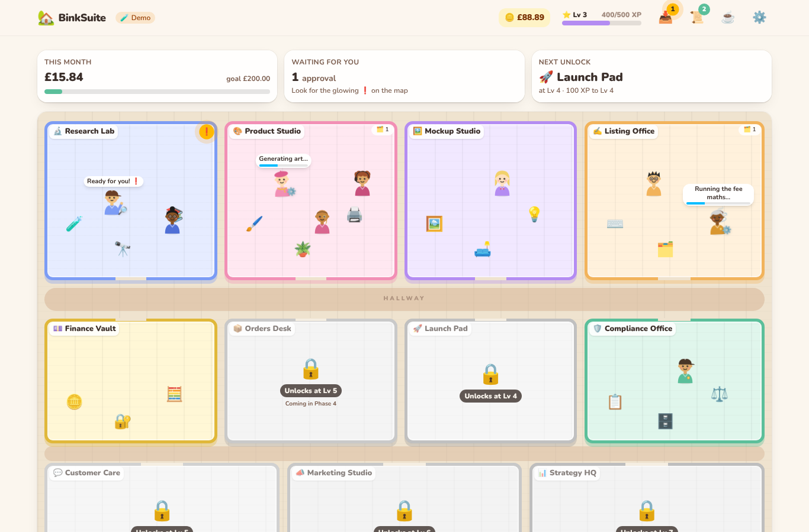
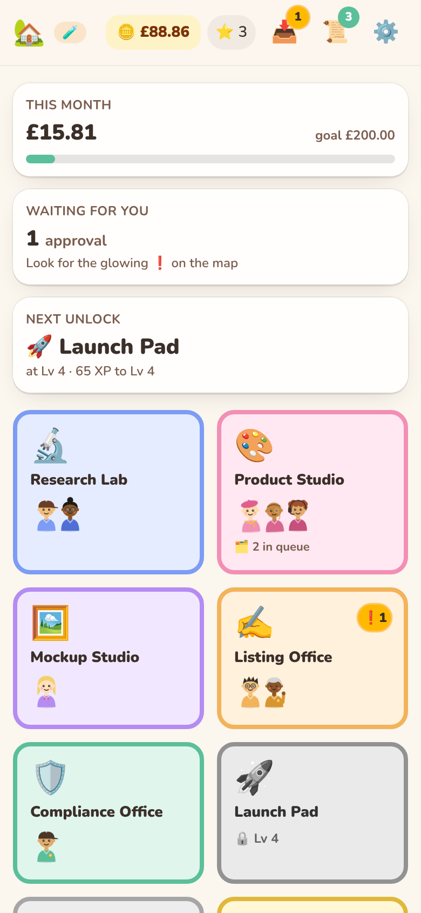
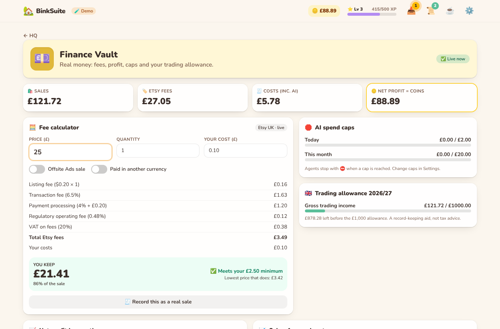
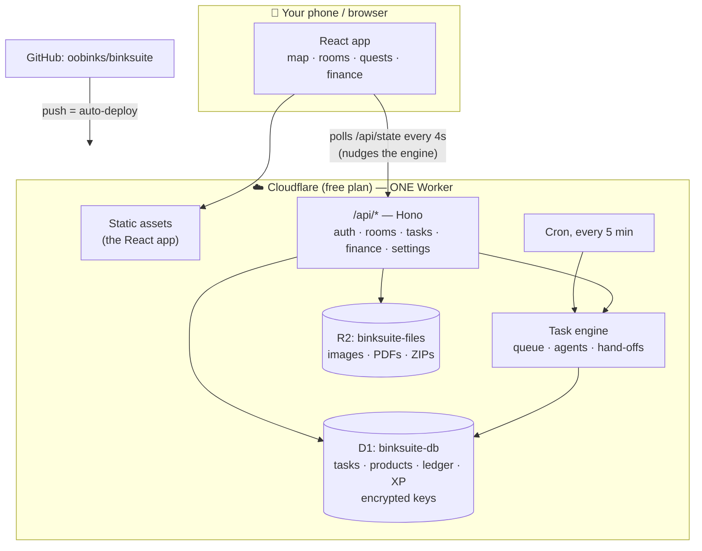
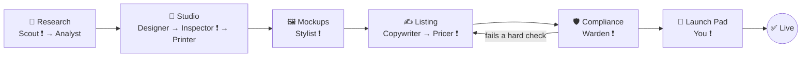
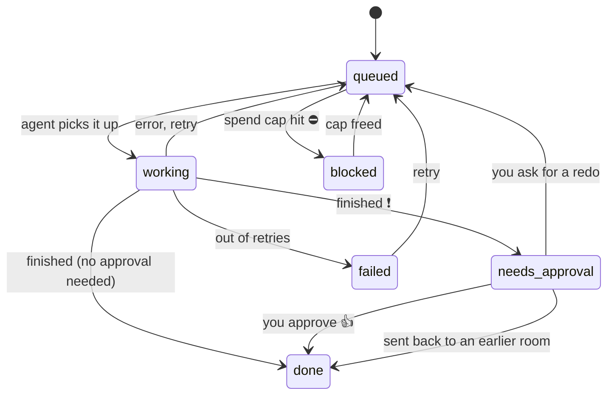
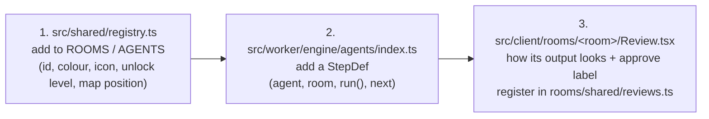

# 🏡 BinkSuite

A cosy management game for running an Etsy printables shop. Your HQ is a floor plan of rooms. Each room is staffed by AI agents who do real work, you approve their output, and your score is real net profit in £.

- **New here? Start with the [owner setup guide](docs/SETUP.md).** It takes about 15 minutes in the Cloudflare dashboard, with no tools to install.
- The full roadmap is in [docs/PLAN.md](docs/PLAN.md).

| HQ (desktop) | HQ (phone) | Finance Vault |
|---|---|---|
|  |  |  |

## How it fits together



## The product pipeline (the 📦 parcels on the map)



❗ = waits for your approval. Steps without ❗ hand off automatically.

## A task's life



The rules live in `src/shared/tasks.ts`, and the engine refuses any other move. Anything that publishes, sends, overspends or deletes creates an `approvals` record and only happens after you tap Approve.

## Phase 1: what's real and what's demo

| Real now | Demo (real AI in later phases) |
|---|---|
| Login, Key Vault, settings, export | Agent output in Research, Studio, Mockups, Listing, Compliance |
| Fee calculator, ledger, charts, CSV, trading-allowance tracker | Demo sales trickling in for demo products |
| Task queue, hand-offs, XP, levels, quests, achievements | Demo art (drawn in your browser from a seed, no image API) |
| Compliance rules (the Warden runs the real checks) | |

Demo data is flagged in the database. Switching **Demo mode** off in Settings hides it and starts your real game at Lv 1. Ledger entries you type in are always real.

## Code layout

```
src/client/        React app (Vite + Tailwind + Motion + TanStack Query + Zustand)
  hq/              floor-plan map, phone grid, parcels
  agents/          SVG avatars, agent cards, activity logs
  game/            journal (quests, achievements, ladder), briefing, approvals inbox
  rooms/<room>/    one folder per room's review screen; rooms/finance is the Finance Vault
  settings/  auth/
src/worker/        Hono API on Cloudflare Workers
  routes/          auth, hq (state/rooms/tasks), finance, settings
  engine/          queue.ts (task engine), agents/ (pipeline steps), game.ts, stats.ts, snapshot.ts
  providers/image  swappable ImageProvider (demo now; OpenAI/Replicate/Ideogram in Phase 2)
  db/              Drizzle schema + self-applying migrations
  cron.ts
src/shared/        registry (rooms/agents), fees, compliance, game rules, task state machine
migrations/        D1 SQL (generated by drizzle-kit)
seed/              demo shop
test/unit, test/api  Vitest (API tests run inside the Workers runtime with a local D1)
```

## Adding a room or an agent



The map, phone grid, unlock ladder, agent toggles and status bubbles all read the registry, so they update themselves.

## Free-plan friendliness

- **One Worker** serves both the app and the API, with one URL.
- **CPU:** each request does a few D1 queries and no heavy maths. PDF, ZIP and image work (Phase 2) runs in your browser.
- **D1 reads:** the HQ polls every 4 seconds, so totals (XP, coins, quests) are cached in one row and only recomputed when something changes. Task progress is calculated from the start time, not written on every poll.
- **Cron:** 1 trigger (every 5 minutes) moves queued work along. Demo products and sales are only invented while the app is open.

## For developers (in the cloud session)

```bash
npm install
cp .dev.vars.example .dev.vars   # local secrets
npm test                         # unit + Workers-runtime API tests
npm run build                    # typecheck + build client and worker
npx vite preview                 # run the built app on a local workerd + D1
node scripts/screenshots.mjs     # click-through + screenshots (needs preview running, fresh DB)
npx drizzle-kit generate         # after editing src/worker/db/schema.ts
```
