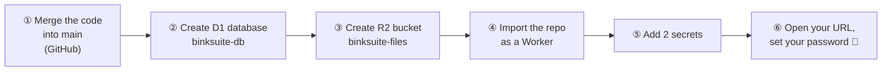
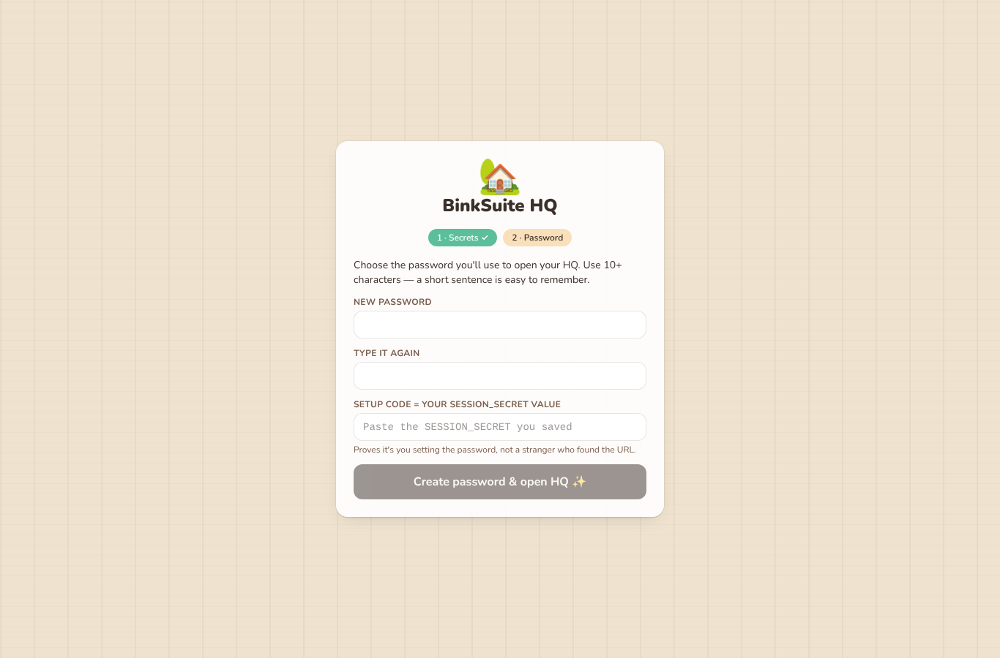

# 🏡 BinkSuite — Owner setup guide (about 15 minutes)

You don't need Node, Git or a terminal. Everything happens in two websites: **GitHub** and the **Cloudflare dashboard**.



> Cloudflare occasionally renames menu items. If a label below doesn't match exactly, look for the closest one. The order of the steps is what matters.

---

## ① Get the code onto `main`

The Phase 1 code is on the branch `claude/stoic-cray-pjd9jv`. Cloudflare deploys your **live** site from `main`.

1. On GitHub, open **oobinks/binksuite**.
2. Open the pull request for the branch. (Claude can open it for you; just ask.)
3. Click **Merge pull request** → **Confirm merge**.

---

## ② Create the database (D1)

1. Go to **dash.cloudflare.com** and log in.
2. In the left sidebar, click **Storage & databases** → **D1 SQL database**.
3. Click **Create database**.
4. **Name:** `binksuite-db` (exactly this, all lower case).
5. Leave the location on **Automatic**. Click **Create**.

You don't need to create any tables. BinkSuite builds them itself the first time it runs.

---

## ③ Create the file bucket (R2)

1. In the left sidebar, click **R2 object storage**.
2. If this is your first time, Cloudflare asks you to **enable R2** and may ask for a payment card.
   - The first **10 GB is free**. You're only charged if you go over, at about $0.015 per GB per month.
   - BinkSuite shows a storage gauge in **Settings** so you'll see it coming.
3. Click **Create bucket**.
4. **Bucket name:** `binksuite-files`.
5. Leave the location on **Automatic** and the storage class on **Standard**. Click **Create bucket**.

> If you skip ② or ③, the first deploy creates them for you with these same names. Doing it yourself just means you know where they live.

---

## ④ Import the repository as a Worker

1. In the left sidebar, click **Compute (Workers)** → **Workers & Pages**.
2. Click **Create** → choose **Import a repository**.
3. Click **Connect GitHub**. In the GitHub pop-up:
   - choose **Only select repositories** → pick **binksuite**,
   - then click **Install & Authorize**.
4. Back in Cloudflare, select **oobinks / binksuite**.
5. Fill in the form:

   | Field | Value |
   |---|---|
   | Project name | `binksuite` |
   | Production branch | `main` |
   | Build command | `npm run build` |
   | Deploy command | `npx wrangler deploy` |
   | Non-production branch deploy command | `npx wrangler versions upload` |
   | Path / root directory | *(leave empty)* |

6. Click **Create and deploy**. The first build takes 1–3 minutes. You can watch the log.
7. When it's done, Cloudflare shows your URL, something like **`https://binksuite.<your-name>.workers.dev`**.

**Preview URLs:** every other branch that gets pushed builds a separate preview link. It appears under **binksuite → Deployments**. Use these to try each new phase on your phone before it goes live.
Previews use the same database as your live site.

---

## ⑤ Add the two secrets

Open your new URL. The setup page makes two random secrets **in your browser** and shows them with 📋 Copy buttons:

```
┌──────────── BinkSuite setup ─────────────┐
│ ① Secrets      ② Password                 │
│                                           │
│ SESSION_SECRET            [📋 Copy]        │
│ k3Jx…(long random text)…                  │
│ VAULT_MASTER_KEY          [📋 Copy]        │
│ Qp9v…(long random text)…                  │
└───────────────────────────────────────────┘
```



1. **Save both values somewhere safe**, for example a password manager or a private note.
   - You'll need `SESSION_SECRET` once more in step ⑥.
   - If you ever lose `VAULT_MASTER_KEY`, any API keys stored in the Key Vault can't be decrypted, and you would just type them in again.
2. In Cloudflare, go to **Workers & Pages** → **binksuite** → **Settings** → **Variables and Secrets**.
3. Click **+ Add**. Then:
   - **Type:** Secret
   - **Variable name:** `SESSION_SECRET`
   - **Value:** paste the first value
   - Click **Deploy** (or **Save**).
4. Click **+ Add** again and do the same for `VAULT_MASTER_KEY` with the second value.
5. Go back to the BinkSuite tab and click **"I've added them — check again"**.

---

## ⑥ Set your password

1. Type a password of **10+ characters**. A short sentence is easy to remember.
2. Type it again.
3. In **Setup code**, paste your `SESSION_SECRET`. This proves the person setting the password is you and not a stranger who found the URL.
4. Click **Create password & open HQ ✨**.

You land in the HQ with a demo shop and the daily briefing.

- **Lockout:** after 5 wrong passwords, login locks for 15 minutes, and the lock gets longer for repeated tries.
- **Change your password** any time in **Settings → Account & data**. Changing it logs out every other device.

---

## If something goes wrong

| What you see | What to do |
|---|---|
| The build log mentions `binksuite-db` or `binksuite-files` not found | Check the names in ② and ③ match exactly, then click **Retry build**. |
| A red banner says a secret is missing | Redo step ⑤. Names are case-sensitive. |
| "Setup code doesn't match" | Paste the exact `SESSION_SECRET` value, with no spaces. |
| Anything else | Copy the message (or a screenshot) to Claude. |
